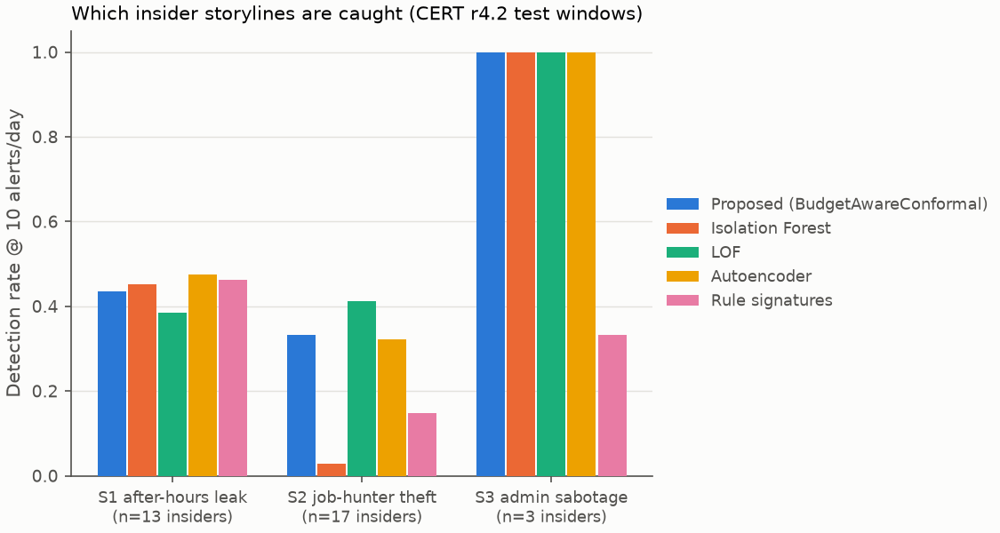

# Insider-Threat Detection on Cloud Audit Logs at Operationally Realistic Alert Budgets

Project P20. Detect misuse of legitimate credentials in enterprise audit logs (logons, removable
media, file copies, email, web), evaluated on the **CMU SEI CERT Insider Threat r4.2** benchmark. Every
detector is judged where a security team actually operates: **a fixed number of alerts an analyst can
review per day**. Every alert says **which behaviour deviated**.

## Problem
Detection research reports area-under-curve figures computed over all operating points. A SOC runs
at one point, set by how many alerts an analyst can examine each day, which is a small number. A
detector with an excellent curve can be useless at ten alerts per day. And an alert that does not
say which aspect of behaviour deviated cannot be triaged, so it gets dismissed.

## Objectives
| ID | Objective |
|---|---|
| O1 | Anomaly detection over audit logs capturing deviation in identity behaviour, resource access and temporal pattern |
| O2 | Evaluate detection at fixed alert budgets (10, 50, 100 alerts/day) that reflect analyst capacity |
| O3 | For each alert, an explanation naming the specific behavioural deviation responsible |
| O4 | Assess whether those explanations let a reviewer triage the alert correctly |

## Hypotheses (falsifiable)
All stated against Isolation Forest on the identical feature matrix, at **B = 10 alerts/day**, on the
**test** windows of CERT r4.2 (3 rolling temporal origins; detector seeds 0-4):
- **H1a** detection rate is at least **40%** higher (relative);
- **H1b** precision is at least **30%** higher (relative);
- **H2** median time to detection is at least **25%** lower;
- **H3** reviewers shown only the explanation triage with balanced accuracy at least **20 percentage
  points** above reviewers shown only the score.

**Falsification rule:** a hypothesis is *supported* only if the **whole** 95% interval lies beyond its
threshold. Intervals: paired bootstrap over **insiders** (H1a, H2) and over **test days** (H1b), each
pooled over the overlapping origins; stratified bootstrap over alerts (H3). Otherwise it is reported
as *not supported*. The thresholds are unchanged from the synthetic version of this project; only
the resampling unit changed (one fixed dataset has no independent seeds), and that change was
written down before any CERT test-window result was computed.

<!-- RESULTS:START -->
## Results (CERT r4.2 test windows, 3 origins pooled, 10 alerts/day; CIs in `results/campaign/summary.csv`)

| Detector | DR@10 [95% CI over insiders] | P@10 [95% CI over days] | DR@50 | AUC-ROC |
|---|---|---|---|---|
| **Proposed (BudgetAwareConformal)** | **0.434** [0.28, 0.60] | **0.028** [0.021, 0.036] | 0.919 | 0.850 |
| Isolation Forest | 0.284 [0.15, 0.44] | 0.007 [0.003, 0.010] | 0.651 | 0.752 |
| LOF | 0.455 | 0.014 | 0.768 | 0.781 |
| Autoencoder | 0.443 | 0.011 | 0.776 | 0.759 |
| Rule signatures | 0.288 | 0.010 | 0.485 | 0.590 |

Oracle precision ceiling at 10 alerts/day: 0.230 (few user-days are malicious).

**Hypothesis verdicts vs Isolation Forest** (whole 95% CI beyond the threshold = supported):

| Hypothesis | Relative difference [95% CI] | Verdict |
|---|---|---|
| H1a DR@10 ≥ +40% | +53% [-7%, +188%] | NOT SUPPORTED |
| H1b P@10 ≥ +30% | +329% [+172%, +723%] | SUPPORTED |
| H2 MTTD ≤ −25% | +22% [-80%, +503%] | NOT SUPPORTED |
| H3 triage | | SUPPORTED |



<!-- RESULTS:END -->

## Data
**CMU SEI CERT Insider Threat Test Dataset, release r4.2** (generated by ExactData's Dynamic Data
Generator for CMU SEI; it is a simulated organisation, not real employee data). About 1,000 users,
Jan 2010 - May 2011, logs of logons, USB devices, files copied to removable media, email and web
browsing. **70 insiders** in three storylines: S1 after-hours USB use and a leak-site upload (30),
S2 job hunting then data theft before leaving (30), S3 a disgruntled admin who logs in as his
supervisor (10). Labels come from the separately distributed answers archive.

The data is licensed: it is **not** in this repository and must not be redistributed. Download
`r4.2.tar.bz2` and `answers.tar.bz2` from CMU KiltHub, unpack them to `data/raw/cert/` (giving
`data/raw/cert/r4.2/` and `data/raw/cert/answers/`), then run `python -m cti.ingest.cert` once.

## How it works (one paragraph)
CERT logs → **27 causal features per user-day** in four families (identity, resource, temporal,
volume) → **BudgetAwareConformal**:
- **C1** compares every user with *their own* history (robust z-scores);
- **C2** turns per-family deviations into conformal p-values against a calibration set pooled over
  all users;
- **C3** fuses the family p-values;
- **C4** optionally suppresses repeat alerts on the same user.

Each alert is explained by its most deviant family and features. Settings are tuned **only** on
validation windows inside a development period that ends before the first test day, and frozen
before the test campaign.

## Reproduce
```bash
pip install -e ".[dev]"
python -m pytest -q                      # all tests (use tiny hand-made data, no licensed data)
python -m cti.ingest.cert                # one-time: CERT CSVs -> parquet (~30 min, needs ~16 GB unpacked)
python run_pipeline.py                   # one run: metrics, explanations, SHAP cross-check
python scripts/tune_proposed.py          # model selection on development-period VALIDATION windows only
python scripts/run_campaign.py           # 5 seeds x 3 origins on TEST windows
python -m cti.eval.figures               # figures from the campaign
python scripts/run_ablation.py           # which component causes the gain
python scripts/run_sweep.py              # budget / suppression / calibration / organisation-size sweeps
python scripts/build_docs.py             # paper (PDF), threats, evidence matrix, this README's results
python scripts/live_demo.py --scenario S2   # live demo: one insider's day in the analyst queue
streamlit run src/cti/demo/app.py        # analyst dashboard
```
Testbed (LocalStack, AWS-compatible): `docker compose up -d` then `python scripts/capture_evidence.py`
(see `docs/TESTBED.md`).

## Repository map
| Path | What |
|---|---|
| `src/cti/ingest/cert.py` | CERT r4.2 loader: CSV -> compact parquet, ground truth from the answers, LDAP roles |
| `src/cti/features/cert.py` | Causal user-day features (four families) and labels |
| `src/cti/detectors/` | `proposed.py` (BudgetAwareConformal), `train.py` (IF, LOF, autoencoder), `rules.py` (8 DLP/UEBA-style signatures) |
| `src/cti/eval/` | `evaluate.py` (per-day budget metrics), `aggregate.py` (insider / day bootstrap), `figures.py` |
| `src/cti/explain/explain_proposed.py` | Alert explanations + SHAP cross-check |
| `src/cti/triage/` | Triage study generator and scorer (O4) |
| `src/cti/experiment.py`, `src/cti/util/splits.py` | Leak-free train / val / test harness, development-period tuning splits |
| `scripts/` | Tuning, campaign, ablation, sweeps, docs build, live demo |
| `configs/` | `default.yaml`, `rules.yaml`, frozen `proposed_final.yaml` / `baseline_final.yaml` |
| `results/`, `figures/` | Outputs (each figure has a CSV table next to it) |
| `docs/` | Paper, related work, threats to validity, evidence matrix, triage study, demo runbook |

## Honest limitations
- CERT r4.2 is a widely used **benchmark generated by a simulator**, not real employee data, and it
  contains no cloud logs.
- One fixed organisation: results are not replicated across independent datasets.
- Keyword lists (job sites, leak sites) were fixed from general knowledge and the public scenario
  descriptions, which name the kinds of sites involved.

See `docs/THREATS_TO_VALIDITY.md`.

Copyright of the CERT data: © 2011 ExactData, LLC, All Rights Reserved. Code license: MIT
