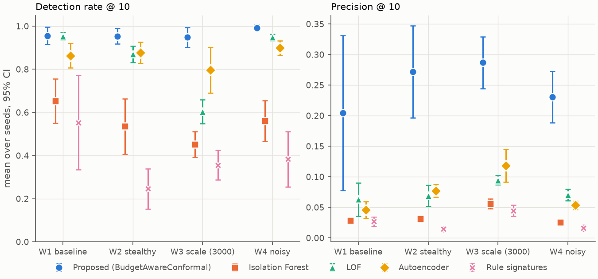
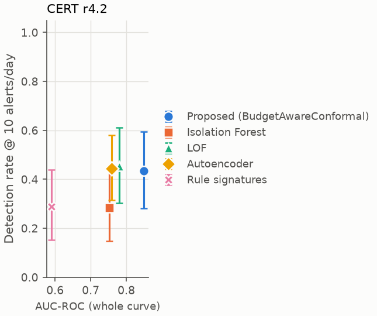
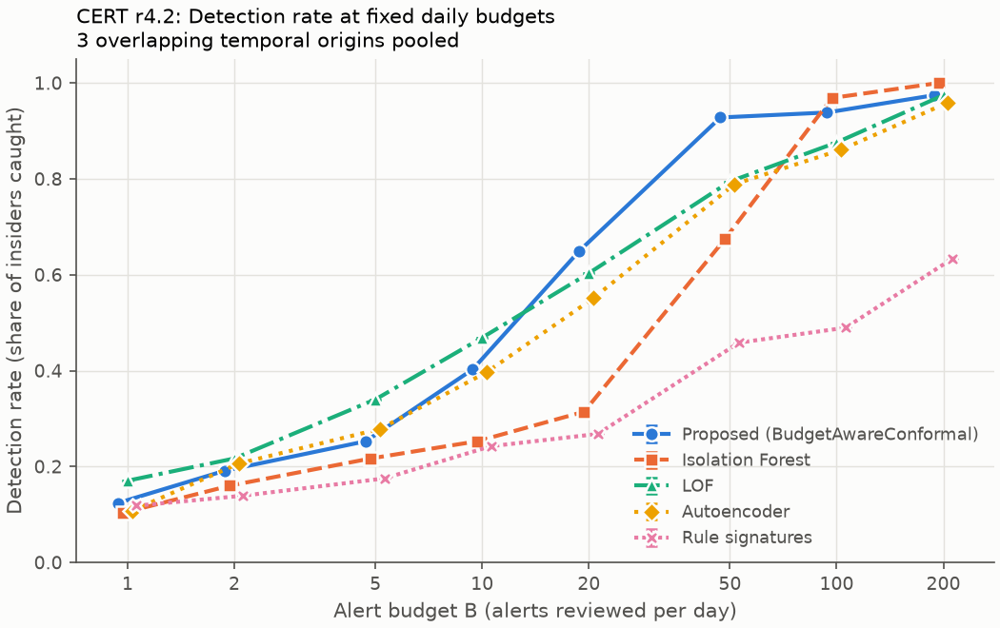

# Insider-Threat Detection on Cloud Audit Logs at Operationally Realistic Alert Budgets

**[Team member names, affiliation]** · Project P20 · October 2026

Code: **[GitHub URL]** · Demo video: **[video URL]**

---

## Abstract

Insider-threat detectors for cloud audit logs are usually compared by the area under the ROC
curve. A security team, however, works at a single operating point: the few alerts an analyst can
review each day. Alerts that do not say *what* deviated are dismissed. We evaluate detectors on
AWS-CloudTrail-style audit logs at **fixed daily alert budgets** (10, 50 and 100 alerts/day). We
propose *BudgetAwareConformal*, which judges every identity against its own history with robust
per-feature deviations, calibrates them with pooled split-conformal p-values, keeps four behaviour
families (identity, resource, timing, volume) separate, and explains each alert by naming the
deviating family and features. On synthetic organisations with five planted insider scenarios
(4 workloads x 5 seeds x 3 rolling temporal origins; settings frozen on separate validation data),
at 10 alerts/day the method detects 96% of insiders against
65% for Isolation Forest on the baseline workload, with
0.204 vs 0.028
precision (oracle ceiling 0.30). The pre-registered
relative-gain hypotheses hold in 7 of 8 workload tests. An ablation shows the gain comes from
per-identity baselines, pooled calibration and family separation, and mostly from resource-access
deviations. Duplicate suppression does not help. A crossover triage study with four reviewers
measures whether the explanations alone suffice for triage.

## 1 Introduction

Cloud control planes record every API call (who, what action, which resource, outcome) in audit
logs such as AWS CloudTrail. When credentials are misused by an insider, or by an outsider holding
valid credentials, this log is often the only evidence. Detection research usually reports
threshold-free metrics such as AUC-ROC. But a Security Operations Centre (SOC) runs at one fixed
point: analysts can examine only a small number of alerts per day. Analysts report that the vast
majority of alarms they see are false positives and that they need alarms that are explainable and
contextual [9]. A detector with a good curve can still be useless at ten alerts per day, and an
alert that only says "anomalous" will be dismissed.

We address both gaps with four objectives:
**O1** detect deviations in identity behaviour, resource access and temporal pattern;
**O2** evaluate at fixed alert budgets reflecting analyst capacity;
**O3** generate per-alert explanations naming the deviation responsible; and
**O4** test whether those explanations let a reviewer triage the alert.

**Contributions.**
(i) A leak-free evaluation protocol for cloud audit-log insider detection at fixed *per-day*
alert budgets, reporting detection rate, precision against its oracle ceiling, and time to detection
with confidence intervals over independent seeds.
(ii) BudgetAwareConformal, a per-identity detector with pooled conformal calibration that is fast
(seconds for 3,000 identities) and explains every alert from its own attribution.
(iii) A component and feature-family ablation and parameter sweeps that locate where the gain comes
from, including a negative result for alert suppression.
(iv) A pre-registered crossover triage study protocol for explanation usability.
(v) A reproducible synthetic CloudTrail testbed with five insider scenarios and benign look-alikes.

## 2 Related Work

*Insider-threat detection.* Most work uses the synthetic CERT data and reports AUC, accuracy or F1
[2, 3, 4]. Le and Zincir-Heywood [1] evaluate unsupervised ensembles against an *investigation
budget* expressed as a share of all sessions. We instead fix the number of alerts per day, which is
how an analyst queue operates. Facade [5] shows at Google scale that judging an event in the context
of its user and resource is what makes precision workable, but its data and system are private.

*Cloud audit logs.* Isolation Forest is used directly on CloudTrail for credential-abuse detection
and evaluated with F1 [6]. Cloud anomaly benchmarks focus on operational faults and per-case
classification [7].

*Calibration.* Conformal p-values give distribution-free outlier tests [8]. We apply them to
per-identity normalised scores pooled across identities.

*Explanations and analysts.* Pitfalls such as temporal snooping, inappropriate metrics and the
base-rate fallacy are common in security ML [10]. Only 14% of security XAI studies evaluate
explanations with users [11]. SHAP-based insider-threat work re-classifies or labels detections
automatically [12, 13]. Alert-fatigue work acts downstream on IDS alerts with supervision [14]. The
full verified gap table is in `docs/related_work.md`.

## 3 Problem and Hypotheses

Detectors score every (identity, day). Each day the analyst receives the top-*B* scored rows.
Hypotheses are stated against Isolation Forest on the identical feature matrix, at *B* = 10, on
the test windows, with 95% intervals from a paired bootstrap over seeds. A hypothesis counts as
supported only if the whole interval clears its threshold.

- **H1a** detection rate at 10 alerts/day is at least 40% higher (relative) than Isolation Forest;
- **H1b** precision at 10 alerts/day is at least 30% higher;
- **H2** median time to detection is at least 25% lower;
- **H3** reviewers shown only the explanation triage alerts with balanced accuracy at least 20
  percentage points above reviewers shown only the anomaly score.

## 4 Method

### 4.1 Testbed and data
CERT data was not used (a deliberate scope decision; see Section 7). A vectorised generator
produces CloudTrail-schema events for 1,000-3,000 identities over 180 days. Five roles (analyst,
developer, admin, backup service, CI runner) each have time zones, working hours, IPs, user agents
and a personal working set of S3 buckets. Benign look-alikes include admin on-call bursts,
backup-service night reads, travel from new IPs, logins without MFA, developer error bursts,
admin key creation and month-end spikes. Five insider scenarios are planted:

| ID | Scenario | Signature |
|---|---|---|
| S1 | Exfiltration after hours | 03:00 login from new IP, ~50 sensitive reads, public snapshot |
| S2 | Departing insider | three-week ramp of sensitive reads, then write to an external bucket |
| S3 | Privilege escalation | key for another user, assume admin, policy change, external e-mail |
| S4 | Credential stuffing | burst of failed logins from a new IP, success, reconnaissance |
| S5 | Low-and-slow | a few extra reads of one sensitive bucket every working day for a month |

Four workloads vary the conditions: **W1** baseline; **W2** stealthy (attack magnitude halved,
slow scenarios twice as likely); **W3** 3,000 identities; **W4** 2.5x more benign look-alikes and
more service accounts. A LocalStack (AWS-compatible) container is the cloud testbed.

### 4.2 Features (O1)
32 features per identity-day in four families, all **causal**: anything "new" or
"usual" is computed only from earlier days, and a test checks that appending future events never
changes earlier rows.
- *Identity:* never-seen IPs, user agents and regions; failed logins; logins without MFA; error rate.
- *Resource:* never-touched resources; sensitive-bucket access; writes to external buckets;
  privilege-escalating and IAM-write actions; public exposure; rare API actions.
- *Temporal:* after-hours share; distance from the identity's usual hour; weekend activity; burstiness.
- *Volume:* event and byte volume; distinct actions and services; never-used actions.

### 4.3 BudgetAwareConformal
- **C1, per-identity surprisal.** For identity *u* and feature *f*:
  *z = max(0, (x - med_u,f) / s_u,f)*, where med and MAD are taken over *u*'s history (log-scale).
  They are shrunk towards the population for short histories, and the scale is floored by a
  population scale.
- **C2, pooled conformal calibration.** Per family, the largest deviation becomes a family score.
  The last 30% of the fit window is held out: baselines are estimated on the earlier part, and the
  held-out family scores of *all* identities form a pooled calibration set (~2x10^4 rows). A family
  p-value is *p = (1 + #{cal >= s}) / (n + 1)*. Per-identity calibration sets of ~30 days cannot
  produce p-values below 1/31, which is what made the original per-identity design fail.
- **C3, fusion.** Family p-values are combined. Validation selected the Bonferroni minimum
  (*score = -log10(min p x 4)*) over Fisher, harmonic-mean and Stouffer fusion.
- **C4, suppression** (optional). Skip an identity alerted in the last *k* days. Validation
  selected *k = 0* (off).

**Explanations (O3).** For each alert: the family with the smallest p-value, its top-3 features by
deviation, today's value and the identity's usual value, plus any other family with p < 0.01. A
Kernel-SHAP cross-check on 20 alerts compares SHAP's top feature with the named features.

### 4.4 Baselines
Isolation Forest (the baseline named in the problem statement; tuned on validation under the same
protocol), Local Outlier Factor and an MLP autoencoder, all on the identical feature matrix. A
12-rule signature engine in the style of commercial cloud threat detection (root use, public
exposure, logging disabled, admin role assumed by a non-admin, brute force then success, and others).

## 5 Experimental Setup

- **Splits.** The first 14 days are history only. On the remaining days, each of 3 rolling origins
  has an expanding train window, a 15% validation window and a 25% test window (42 days).
  Empty windows abort the run.
- **Protocol.** Tuning used only the validation windows of seeds 100-101: 44
  configurations, coordinate descent on mean DR@10, ties broken by P@10. The frozen settings were
  then run on the **test** windows of seeds 0-4 (fit on train + validation).
  That is 60 test windows, covering 1622 insider instances.
- **Metrics at budget B per day.** *DR@B*: fraction of insiders active in the window with at least
  one alert on a malicious day. *P@B*: true alerts / alerts. *Oracle P@B*: best precision achievable
  given the positives per day. *MTTD*: hours from attack onset to the end of the alerting day
  (alerts are a daily batch). AUC-ROC is reported for reference.
- **Statistics.** Origins are averaged within a seed. We report the mean and 95% t-interval over
  the five seeds (clipped to [0, 1] for rates), and a paired seed bootstrap (10,000 resamples) for
  the hypotheses.

## 6 Results

### 6.1 Detection at 10 alerts/day

| Workload | Proposed DR@10 | Isolation Forest | LOF | Autoencoder | Rules |
|---|---|---|---|---|---|
| W1 baseline | **0.956** | 0.653 | 0.953 | 0.863 | 0.553 |
| W2 stealthy | **0.954** | 0.536 | 0.870 | 0.877 | 0.246 |
| W3 scale | **0.948** | 0.451 | 0.604 | 0.796 | 0.356 |
| W4 noisy | **0.992** | 0.561 | 0.948 | 0.899 | 0.383 |

| Workload | Proposed P@10 | Isolation Forest | LOF | Autoencoder | Rules | Oracle |
|---|---|---|---|---|---|---|
| W1 | **0.204** | 0.028 | 0.063 | 0.046 | 0.027 | 0.304 |
| W2 | **0.272** | 0.031 | 0.069 | 0.077 | 0.014 | 0.511 |
| W3 | **0.287** | 0.056 | 0.094 | 0.118 | 0.044 | 0.710 |
| W4 | **0.230** | 0.026 | 0.070 | 0.054 | 0.016 | 0.323 |

*Table 1. Means over 5 seeds (each the average of 3 temporal origins). 95% intervals are in
`results/campaign/summary.csv` and in Figure 1.*


*Figure 1. Detection rate and precision at 10 alerts/day per workload, mean and 95% CI over seeds.*

**Hypotheses.**

| | W1 | W2 | W3 | W4 |
|---|---|---|---|---|
| H1a DR@10 >= +40% | +46% [+31%, +65%] **NOT SUPPORTED** | +78% **SUPPORTED** | +110% **SUPPORTED** | +77% **SUPPORTED** |
| H1b P@10 >= +30% | +624% **SUPPORTED** | +769% **SUPPORTED** | +413% **SUPPORTED** | +796% **SUPPORTED** |
| H2 MTTD <= -25% | -35% **NOT SUPPORTED** | -81% **SUPPORTED** | -5% **NOT SUPPORTED** | -13% **NOT SUPPORTED** |

H1 holds in 7 of 8 tests. On W1, H1a's point estimate exceeds +40% but its interval does not.
H2 holds only on the stealthy workload: with daily batches, every detector that catches an insider
does so within about a day, so there is little room to be faster.

**Where the gain comes from (W1, DR@10 per scenario).** Isolation Forest catches the loud
single-day attacks (S1 100%, S4 100%) but misses most
slow ones (S2 29%, S5 48%). The proposed detector
reaches S2 100% and S5 88%: slow attacks are small
deviations for the population but large ones for the individual.

### 6.2 The curve versus the operating point
Ranked by AUC-ROC, the proposed method is first on every workload, and the ranking at 10
alerts/day agrees at the top. Between baselines the order changes: LOF and the autoencoder swap
places in W2 and W4, and 9% of detector pairs flip across individual runs. More importantly, AUC
compresses differences that matter at the operating point. On W4, Isolation Forest's AUC
(0.753) is almost that of LOF (0.762),
yet at 10 alerts/day it catches 56% of insiders against
95% (Figure 2).


*Figure 2. Whole-curve AUC (x) vs detection rate at 10 alerts/day (y).*

### 6.3 Ablation: which component causes the gain? (W1 / W2, seeds 0-2)

| Variant | DR@10 W1 | P@10 W1 | DR@10 W2 | P@10 W2 |
|---|---|---|---|---|
| Full (tuned) | 0.951 | 0.168 | 0.951 | 0.238 |
| -C1 population baseline | 0.925 | 0.040 | 0.869 | 0.052 |
| -C2 no calibration | 0.938 | 0.046 | 0.890 | 0.064 |
| -C3 one pooled family | 0.932 | 0.041 | 0.878 | 0.059 |
| +C4 suppress 3 days | 0.944 | 0.072 | 0.956 | 0.112 |
| Fisher fusion | 0.892 | 0.092 | 0.773 | 0.114 |
| -resource family | 0.658 | 0.026 | 0.310 | 0.015 |
| -identity family | 0.951 | 0.169 | 0.956 | 0.284 |
| Isolation Forest | 0.714 | 0.029 | 0.534 | 0.030 |

What the ablation shows:
- Removing per-identity baselines, calibration or family separation each cuts precision by
  roughly 4x.
- Suppression lowers precision: a multi-day insider's repeated alerts are true positives.
- The resource family carries most of the signal. Identity, temporal and volume families add little
  in these organisations (Section 7).

### 6.4 Sweeps: budget, scale and stealth

*Figure 3. Detection rate as the daily budget grows from 1 to 200 (W1, 5 seeds).*

At a budget of **1** alert/day the proposed detector catches 65%
of insiders, against Isolation Forest's 36%. On this workload LOF
matches it on detection at small budgets (71% at 1/day). The
proposed method's advantage over LOF is precision, and robustness as the organisation grows.

As the organisation grows from 250 to 3,000 identities, at 10 alerts/day:

| Detector | DR@10 at 250 | DR@10 at 3,000 | Fit + score time at 3,000 |
|---|---|---|---|
| Proposed | 1.00 | 0.97 | 1.2 s |
| Isolation Forest | 0.96 | 0.47 | 4.0 s |
| LOF | | | 104 s |

Isolation Forest and LOF degrade as identities are added; the proposed detector does not. With
more identities, a global model sees more "normal-looking extremes", while a per-identity baseline is
unaffected.

Cutting attack magnitude to a quarter (stealth x0.25) does **not** lower the proposed detector's
DR@10 (0.97, vs 0.95 at full
strength; Isolation Forest 0.78). This matches the ablation:
the signal is *novelty* (a sensitive resource this identity never touched), which is present whatever
the volume. Attacks that avoid novel resources are the open problem.

`cal_fraction` (0.1-0.4) leaves DR@10 unchanged (0.951 to
0.951), so the result is not sensitive to that choice.

### 6.5 Explanations and triage (O3, O4)
Every alert of the proposed detector carries an explanation, for example:

```
Resource access deviation (p = 0.00058)
  - calls on sensitive buckets (finance / hr / pii / security): 9 (usually 0)
  - share of calls on sensitive buckets: 21% (usually 0%)
```

Kernel SHAP's top feature was among the named features in all 20 cross-checked alerts. This is
expected rather than strong independent validation, because the tuned score is driven by the
largest single family deviation.

**Triage study (pre-registered; `docs/triage_study/PROTOCOL.md`).**
- 40 alerts (20 true, stratified over S1-S5; 20 false), 4 reviewers in a crossover design.
- Arm A shows the score only; arm B shows the explanation only.
- Balanced accuracy: arm A [PENDING: triage study not yet run], arm B [PENDING: triage study not yet run].
- H3 effect: [PENDING: triage study not yet run] [[PENDING: triage study not yet run], [PENDING: triage study not yet run]], verdict
  [PENDING: triage study not yet run].

## 7 Limitations and Threats to Validity
- **Synthetic data.** All results come from our generator. CERT was not used, and LocalStack does
  not provide CloudTrail lookups, so the detector never processed a real CloudTrail stream.
- **We wrote both the attacks and the detector.** The ablation shows the signal is concentrated in
  resource-access novelty. Attacks that stay inside an identity's usual resources are not modelled
  and would be much harder.
- **Tuning favours our method.** Only the proposed method and Isolation Forest were tuned (on
  separate validation seeds); LOF, the autoencoder and the rules use defaults.
- **Small samples.** Five seeds give wide intervals, there are 12 hypothesis tests without
  family-wise correction, and the triage study has 4 reviewers who are also the authors.
- **Simplified operating model.** Labels are per identity-day, and a fixed daily budget is one SOC
  operating model among several.

`docs/THREATS_TO_VALIDITY.md` gives the full list, with numbers.

## 8 Conclusion
Evaluated where analysts actually operate, a fixed number of alerts per day, judging each cloud
identity against its own history with pooled conformal calibration catches far more insiders, with
several times higher precision, than global anomaly detectors and rule signatures on our synthetic
organisations, and every alert explains which behaviour deviated. The negative and qualifying
results matter as much: suppression does not help, the gain rests mainly on resource-access
deviations, and whether explanations improve triage is settled by the human study rather than
assumed. Next steps are real CloudTrail data, attacks that stay inside normal resource sets, and a
triage study with outside analysts.

## References
[1] Le & Zincir-Heywood, IEEE TNSM 18(2), 2021. [2] Yuan & Wu, Computers & Security 104, 2021.
[3] Li et al., arXiv:2108.10567, 2021. [4] Tian et al., Cybersecurity 8, 2025.
[5] Kantchelian et al., Facade, arXiv:2412.06700, 2024. [6] Haunschild et al., Springer ISRL, 2026.
[7] Zou et al., arXiv:2508.01844, 2025. [8] Bates et al., Annals of Statistics 51(1), 2023.
[9] AlAhmadi et al., USENIX Security 2022. [10] Arp et al., USENIX Security 2022.
[11] Nadeem et al., IEEE EuroS&P 2023. [12] Grzeczkowicz et al., CRiSIS 2024 (LNCS 2025).
[13] Faqihi et al., FGCS 2026. [14] Ndichu et al., arXiv:2605.22324 (ACSAC 2026).
Full entries: `docs/references.bib`.
